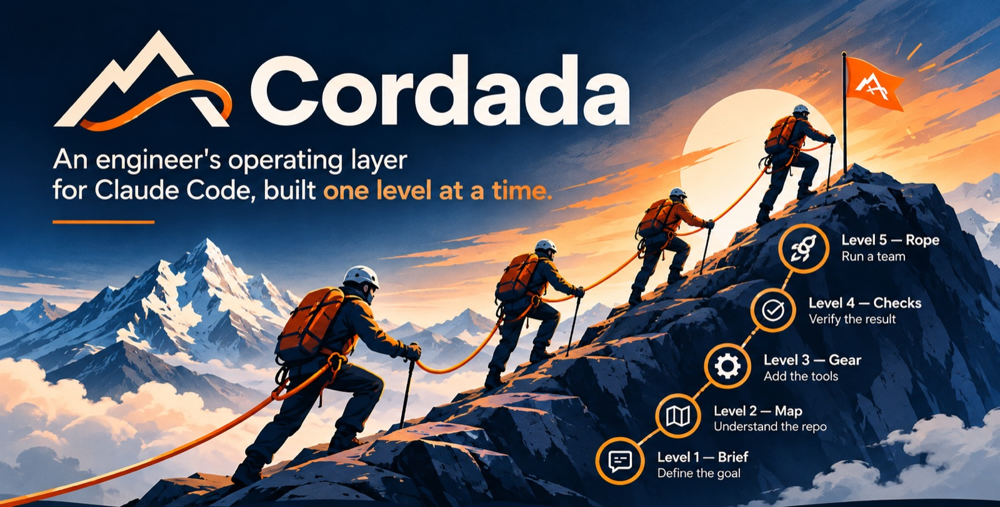

English: [README.md](README.md)

# Cordada



Una capa de trabajo para ingenieros que usan Claude Code, construida de a un nivel.

Una *cordada* es un equipo de escaladores atados a la misma cuerda, que se mueven como una unidad. Acá los escaladores son agentes, la cuerda es una lista de tareas compartida, y la sostenés vos.

**Estado:** temprano. Hecho para un workshop el 2026-11-26. Desde el 2026-11-24 los skills de cada nivel son guías, no hacen el trabajo: cada uno dice qué le falta a tu repo, te da el prompt para pedírselo a Claude, y chequea lo que armaste. Cada skill se probó headless sobre el repo de ejemplo, en sus dos modos. Map, gear, checks, rope y el climb también se corrieron de forma interactiva, de punta a punta. Sin probar: Windows. `./check` corre los tests del propio repo.

## La idea

No hay atajos para correr muchos agentes a la vez. Cada nivel de la escalada deja una cosa en tu repo que el nivel siguiente necesita.

| Nivel | Sumás | Skill | Qué deja en tu repo |
|---|---|---|---|
| 1. Prompt | Brief | `/cordada:brief` | Nada. Un hábito: objetivo, límites, cuándo está listo |
| 2. Context | Mapa | `/cordada:map` | `CLAUDE.md`, opcionalmente un log de decisiones |
| 3. Harness | Equipo | `/cordada:gear` | Un skill del proyecto, un script, un hook de protección |
| 4. Loop | Checks | `/cordada:checks` | `./check` y una definición de "listo" |
| 5. Graph | Cuerda | `/cordada:rope`, después `/cordada:climb` | Una base de tareas con dependencias, y una cordada que la trabaja |

`/cordada:route` te dice qué niveles tiene un repo y cuál sigue. Cada skill revisa los niveles de abajo y avisa cuando falta uno.

## Cómo funciona un nivel

Corré el skill del nivel dos veces:

1. **Guía.** Todavía no está el archivo del nivel, así que el skill explica para qué sirve el nivel, mira tu repo, dice qué falta y te da el prompt para escribir. No escribe nada.
2. **Lo armás vos con Claude.** Escribí el prompt, con tus palabras si querés, y respondé las preguntas de Claude. Vos conocés el proyecto; Claude no.
3. **Chequeo.** Corré el skill de nuevo. Ahora el archivo está, así que lo chequea contra los criterios del nivel, en una tabla, y da un arreglo por cada hueco. Todo bien: commit, y al nivel siguiente.

La primera línea del skill dice qué modo eligió. `/cordada:<skill> guide` fuerza la guía. `brief` no tiene archivo: sin argumento guía, con tu prompt como argumento lo chequea. `climb` es el único skill que hace el trabajo: lidera un equipo de agentes sobre la cola de tareas.

## Instalación

Necesitás [Claude Code](https://code.claude.com/docs) y git. El nivel 5 también necesita [beads](https://github.com/steveyegge/beads) (`bd`).

En Claude Code:

```
/plugin marketplace add guriandoro/cordada
/plugin install cordada@cordada
```

O sin instalar, desde un clon:

```bash
git clone https://github.com/guriandoro/cordada
claude --plugin-dir cordada/plugins/cordada
```

## Probalo en el repo de ejemplo

`sample/` tiene un proyecto chico en Python, `vaquita`: divide los gastos de una comida entre amigos y dice quién le paga a quién. Dos tests fallan a propósito (las partes pierden un centavo) y hay un TODO en markdown. Necesita Python 3.9 o posterior, solo la biblioteca estándar.

```bash
cordada/sample/create.sh vaquita      # una copia nueva, con su propia historia de git
cd vaquita
claude --plugin-dir ../cordada/plugins/cordada
```

Después escalá, un nivel por paso, en una sola ventana de Claude. Corré `/clear` entre niveles: un contexto nuevo que mantiene el plugin.

```
/cordada:route
/cordada:brief add the money module      # mirá lo que deja afuera un prompt pelado
/cordada:map                             # guía, escribí su prompt, correlo de nuevo para chequear
/cordada:gear                            # tres prompts: skill, tool, hook
/cordada:checks                          # ./check, después un loop con /goal
/cordada:rope                            # bd init y dos tareas a mano, después un prompt
/cordada:climb 3                         # una cordada vacía la cola
```

Hacé un commit después de cada nivel. Los prompts de gear escriben en `.claude/`, y Claude Code pide permiso antes: aprobalo. En rope, escribí `!` primero y después pegá cada comando de shell. `/cordada:climb` pide un árbol limpio, para que cada merge se pueda rastrear hasta una tarea, y para después de cinco rondas para que decidas si sigue.

¿Te quedaste atrás, o querés arrancar más arriba? `cordada/sample/create.sh vaquita-3 --level 3` crea un repo que ya está en el nivel 2, 3, 4 o 5, con commit. El nivel 5 necesita `bd`.

## Usalo en tu propio repo

Los mismos pasos, en un repo tuyo. Los skills leen tu repo, nombran lo que falta y te dan los prompts; Claude te pregunta lo que el repo no dice. No se hace ningún commit por vos, y no se pushea nada. `bd init` hace un commit propio para `.beads/`.

## Estructura

- `plugins/cordada/` : el plugin. `skills/`, `agents/climber.md`, `scripts/route`.
- `sample/` : la plantilla del repo de ejemplo y `create.sh`.
- `workshop/` : la tarjeta de ruta y los requisitos para quienes asisten.
