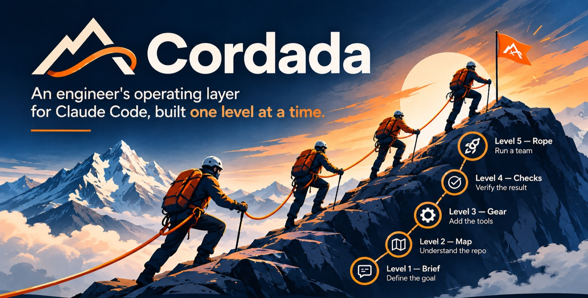

# Cordada



An engineer's operating layer for Claude Code, built one level at a time.

A *cordada* is a rope team: climbers tied to the same rope, moving as one unit. Here the climbers are agents, the rope is a shared task list, and you hold it.

**Status:** early. Built for a workshop on 2026-11-26. Since 2026-11-24 the level skills are guides, not doers: each one says what your repo is missing, gives you the prompt to ask Claude, and checks what you built. Every skill is tested headless on the sample repo, in both modes. Map, gear, checks, rope and the climb were also run interactively, end to end. Not tested: Windows. `./check` runs the repo's own tests.

## The idea

There are no shortcuts to running many agents at once. Each level of the climb leaves one thing in your repo that the next level needs.

| Level | You add | Skill | What it leaves in your repo |
|---|---|---|---|
| 1. Prompt | Brief | `/cordada:brief` | Nothing. A habit: goal, constraints, done |
| 2. Context | Map | `/cordada:map` | `CLAUDE.md`, optionally a decisions log |
| 3. Harness | Gear | `/cordada:gear` | A project skill, a tool script, a guard hook |
| 4. Loop | Checks | `/cordada:checks` | `./check` and a definition of done |
| 5. Graph | Rope | `/cordada:rope`, then `/cordada:climb` | A task database with dependencies, and a rope team to work it |

`/cordada:route` tells you which levels a repo has and which one comes next. Each skill checks the levels below it and says so when one is missing.

## How a level works

Run the level's skill twice:

1. **Guide.** The level's file is not there yet, so the skill explains what the level is for, looks at your repo, says what is missing, and gives you the prompt to type. It writes nothing.
2. **You build it with Claude.** Type the prompt, in your own words if you like, and answer Claude's questions. You know the project; it doesn't.
3. **Check.** Run the skill again. The file is there now, so it checks it against the level's criteria, shown as a table, and gives one fix per gap. All clear: commit, and go to the next level.

The skill's first line says which mode it picked. `/cordada:<skill> guide` forces the guide. `brief` has no file: with no argument it guides, with your prompt as the argument it checks the prompt. `climb` is the one skill that does the work: it leads a team of agents over the task queue.

## Install

You need [Claude Code](https://code.claude.com/docs) and git. Level 5 also needs [beads](https://github.com/steveyegge/beads) (`bd`).

In Claude Code:

```
/plugin marketplace add guriandoro/cordada
/plugin install cordada@cordada
```

Or without installing, from a clone:

```bash
git clone https://github.com/guriandoro/cordada
claude --plugin-dir cordada/plugins/cordada
```

## Try it on the sample repo

`sample/` holds a small Python project, `vaquita`: it splits the cost of a shared meal among friends and says who pays whom. Two tests fail on purpose (the shares lose a cent) and there is a markdown TODO. It needs Python 3.9 or later, standard library only.

```bash
cordada/sample/create.sh vaquita      # a fresh copy, with its own git history
cd vaquita
claude --plugin-dir ../cordada/plugins/cordada
```

Then climb, one level per step, in one Claude window. Run `/clear` between levels: a fresh context that keeps the plugin.

```
/cordada:route
/cordada:brief add the money module      # see what a bare prompt leaves out
/cordada:map                             # guide, type its prompt, run it again to check
/cordada:gear                            # three prompts: skill, tool, hook
/cordada:checks                          # ./check, then a /goal loop
/cordada:rope                            # bd init and two tasks by hand, then a prompt
/cordada:climb 3                         # a rope team drains the queue
```

Commit after each level. Gear's prompts write under `.claude/`, and Claude Code asks before that: approve it. In rope, type `!` first and then paste each shell command. `/cordada:climb` needs a clean tree, so that every merge can be traced to one task, and it stops after five rounds to let you decide whether to go on.

Fell behind, or want to start higher? `cordada/sample/create.sh vaquita-3 --level 3` creates a repo already at level 2, 3, 4 or 5, committed. Level 5 needs `bd`.

## Use it on your own repo

The same steps, in a repo of yours. The skills read your repo, name what is missing and give you the prompts; Claude asks you what the repo cannot tell. Nothing is committed for you, and nothing is pushed. `bd init` makes one commit of its own for `.beads/`.

## Layout

- `plugins/cordada/` : the plugin. `skills/`, `agents/climber.md`, `scripts/route`.
- `sample/` : the sample repo template and `create.sh`.
- `workshop/` : the route card and the prerequisites for attendees.
